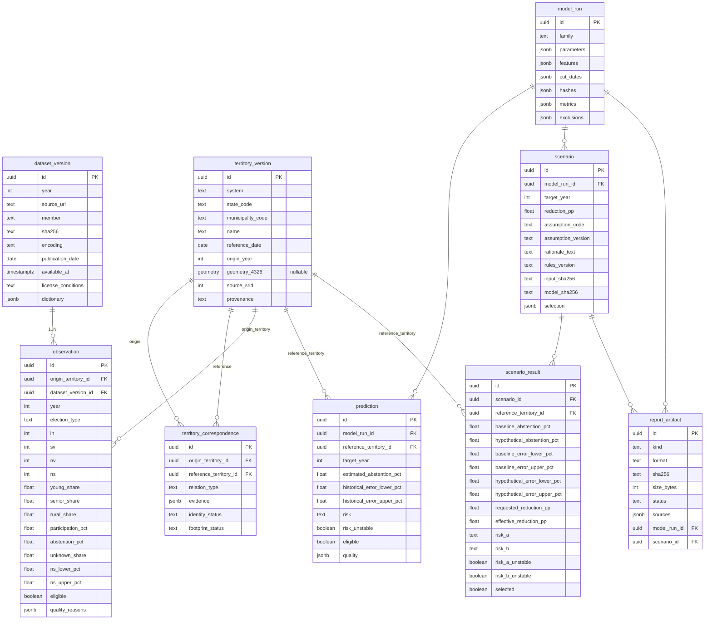

# Modelo de datos — PostGIS (Spec §10)

Base de datos PostgreSQL/PostGIS 17.3.6. El esquema lo crea Alembic
(`alembic/versions/0001_initial.py`) como rol `migrator`; las definiciones de
columna, restricciones (`CHECK` de conteos), unicidades y claves foráneas viven
en `apps/api/participa_geo/db/models.py` (fuente única de verdad). Roles y
permisos: `migrator` (dueño), `writer` (DML), `api` (`SELECT` general e
`INSERT` sólo en `scenario`/`scenario_result`), `gis_reader` (`SELECT` sobre las
vistas publicadas).

## Tablas

| Tabla | Propósito | Clave natural / unicidad |
|---|---|---|
| `dataset_version` | Fuente CCPC: URL, miembro, checksum, licencia/diccionario. | `UNIQUE (year, sha256)`; id = `uuid5` del contenido. |
| `territory_version` | Identidad territorial INE (referencia 2025 con geometría; orígenes por año con geometría `NULL`). | id = `uuid5` determinista. |
| `territory_correspondence` | Origen ↔ referencia con `identity_status` y `footprint_status`. | `UNIQUE (origin, reference)`. |
| `observation` | Conteos municipales agregados (LN/SV/NV/NS) y tasas. | `UNIQUE (origin, year, dataset)`. |
| `model_run` | Familia, parámetros, features, cortes, hashes, métricas, exclusiones. | id = hash de contenido (T4). |
| `prediction` | Estimación/banda/riesgo 2027 por municipio de referencia. | `UNIQUE (run, territory, target_year)`. |
| `scenario` | Supuesto hipotético (reducción 0–10 pp, código de catálogo), versiones y hashes. | `CHECK reduction 0..10`; `CHECK assumption_code`. |
| `scenario_result` | Resultado A/B por municipio, banda traducida e inestabilidad. | `UNIQUE (scenario, territory)`. |
| `report_artifact` | Artefacto de exportación (formato, hash, estado). | — |

`model_run`, `prediction`, `scenario`, `scenario_result` y `report_artifact` se
crean en esta migración (Ruling 1) pero se pueblan en T4/T6/T9.

## Geometría

- `territory_version.geometry` es `geometry(Geometry, 4326)` **nullable**. Sólo
  la referencia 2025 recibe el polígono descargado; las 750 identidades de origen
  (2009–2024) conservan `geometry IS NULL`. Nunca se copia la geometría 2025 a
  una fila etiquetada como año histórico.
- `source_srid` registra el SRID declarado de origen (EPSG:32613). La
  transformación real `32613 → 4326` ocurre en
  `pipelines/validation/geography.py` con `.to_crs(4326)`; jamás `.set_crs`.
- Índice espacial GIST sobre `territory_version(geometry)`.

## Vistas de lectura (GeoServer)

Cuatro vistas sin lógica predictiva, publicadas como capas WMS/WFS de sólo
lectura (`gis_reader`):

- `municipalities`: territorios de referencia con geometría (125).
- `participation_history`: observaciones unidas a su geometría de referencia.
- `predictions`: predicciones unidas a geometría (vacía hasta T4).
- `scenario_results`: resultados de escenario unidos a geometría (A/B, banda
  traducida; expone `risk_b` como `risk` para el estilo de riesgo).

## Diagrama (Mermaid)

## Identificadores reproducibles (sin UUID aleatorios)

- Referencia: `uuid5(URL, 'ine:14:municipality:{código3}:2025-12-15')`.
- Origen: `uuid5(URL, 'ccpc:14:municipality:{código3}:{año}')`.
- Dataset: `uuid5(URL, 'ccpc:14:dataset:{año}:{sha256}')`.
- Correspondencia: `uuid5(URL, 'correspondence:{origen}:{referencia}')`.

La importación y la publicación son **idempotentes**: los identificadores
deterministas y los `ON CONFLICT` garantizan que reejecutar `db load`,
`gis import` o `gis publish` no duplica filas ni capas.

## Carga del modelo (T5)

`model load --bundle-dir data/processed/model` (CLI, rol `writer`) lee los
artefactos T4 —`model.json`, `evaluation.json`, `manifest.json` y
`predictions-2027.parquet`— y persiste un `model_run` y las 125 filas
`prediction` mediante upserts deterministas (sin `pickle`/`joblib` ni
reentrenamiento). El `model_run_id` proviene del artefacto real
(`832b21e9-775a-5a74-9b3b-66b923de4e62`, familia `M0`). El mapeo de los campos del
artefacto a columnas de `model_run` es:

- `parameters` ← `model.json` (alpha, feature_order, intercept/coef/scaler si M1,
  `description`/`candidate_m1` si M0, `limitations`, `features_2027`,
  `explanations` y `candidate_m1_explanations`).
- `features` ← `model.json.feature_order`.
- `cut_dates` ← `reference_date`/`target_year` de `model.json` y
  `validation_year`/`test_year` de `evaluation.json`.
- `hashes` ← `manifest.json` (`data_aggregate_sha256`, `logical_hash`, `artifacts`).
- `dependencies` ← `manifest.json.versions`.
- `metrics` ← `evaluation.json` (`selection`, `metrics`, `band`, `cohorts`).
- `exclusions` ← `evaluation.json.exclusions`.

Cada `prediction` conserva `estimated_abstention_pct` (nulo si
`insufficient`), banda, `risk`, `risk_unstable`, `eligible` y `quality`
(JSONB). `reference_territory_id` es el `territory_id` de la fila del parquet
(uuid5 de la referencia 2025). Reejecutar `model load` con el mismo contenido
no crea otro `model_run` ni duplica predicciones.

## Limitación MVP: credenciales de rol en el contenedor `api`

El contenedor `api` recibe **todas** las contraseñas de rol de base de datos
(`DB_MIGRATOR_*`, `DB_WRITER_*`, `DB_API_*`, `DB_GIS_READER_*`) porque la CLI de
mantenimiento (`db migrate`, `db load`, `model load`, …) corre en la misma
imagen. El **proceso HTTP sólo usa `DB_API_*`**: `main.py` crea un único motor con
el rol de menor privilegio `api` (`SELECT` general e `INSERT` sólo en las dos
tablas de escenario) y nunca toca las credenciales de `migrator`, `writer` o
`gis_reader`. Rediseñar la separación (p. ej. una imagen de mantenimiento
distinta) queda fuera del alcance del MVP y no se hace en T5/T6.

## Permiso de readiness (T5)

La migración `0002` concede `SELECT ON alembic_version TO api` para que el
chequeo de readiness pueda verificar que las migraciones están aplicadas sin
ampliar ningún otro privilegio.

## Escenarios persistidos (T6)

La migración `0003` añade a `scenario` las versiones de supuesto/reglas y los
hashes de entrada/modelo; a `scenario_result`, la banda A, la banda B traducida y
los indicadores de inestabilidad A/B. Recrea la vista `scenario_results`
agregando `risk_b AS risk` (y la banda/flags) para que el estilo de riesgo pueda
renderizar el mapa B. También concede `INSERT` sobre `scenario` y
`scenario_result` al rol `api`; no concede `UPDATE`/`DELETE` ni escritura sobre
predicciones, modelo u observaciones. Los escenarios existentes se conservan
(columnas nuevas con valores por defecto/nullable).
